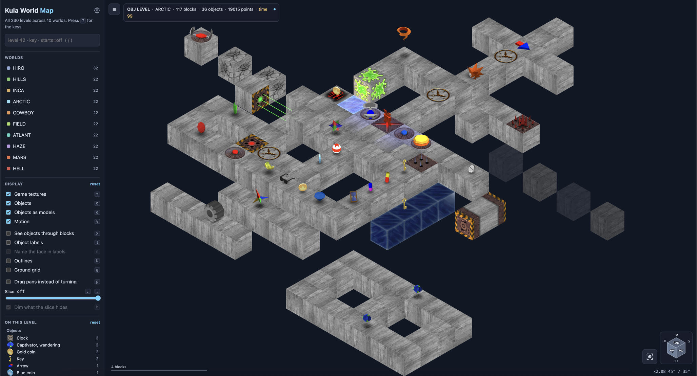

# Kula World Map

An interactive map of every level in **Kula World** (PlayStation), read straight off the disc: the block lattice each level is built from, every object the game places on it, and the level's own name, time and start.

It is at **[kulaworld.retroatlas.org](https://kulaworld.retroatlas.org/)**, part of [RetroAtlas](https://retroatlas.org/), a collection of interactive maps of classic games.



All 230 levels are here, which is more than the game ever shows you in one place: 150 numbered levels across ten worlds, 30 bonus and 10 hidden levels, the 20 finals, the 10 Simon rooms, the nine copies of the object catalogue that no menu reaches, and the lesson, which only the Japanese disc's menu lists and the PAL disc swaps for a tenth copy of the catalogue.

A level is titled by the number the game's pause screen gives it, which the engine counts through the worlds rather than reading from the level record; where the record calls it something else, the level's note says so.

A route can be planned over a level's blocks, stop by stop, drawn the way the ball would roll between them by the game's own rules for a step, and the ball itself can be rolled over the level by the keys, or along the planned route, as the game rolls it, the level turning with it round an edge or up a wall.

The data is read from all three discs the game shipped on, Roll Away in North America (SLUS-00724), Kula World in PAL territories (SCES-01000) and Kula Quest in Japan (SCPS-10064), which share 213 of their 230 levels byte for byte, the PAL disc differing in five slots and the Japanese in thirteen.

The map shows whichever disc a visitor chooses, every level as that disc ships it, and where a level differs between the discs its note says what changed.

The hourglass scores 1190 at most on the North American disc, 990 on the PAL disc and nothing on the Japanese one, so the points and the best score the map gives a level are those of the disc shown.

The map is an editor as well. Make a level of your own, or copy a shipped one and change it: lay blocks against faces or across the floor, put the game's objects on them, run platforms and lasers between two cells, and have the game's own rules refuse what it could not load.

Drafts stay in the browser until they are saved, as the map's own file or as the level the game loads, and drafts can be written onto the game's disc, one or several as one patch for an emulator. [docs/editor.md](docs/editor.md) is the specification of the file format and says how the writers are held to the disc.

## What the disc stores

Every level is one compressed record inside a pack: a fixed 34 x 34 x 34 lattice of cells, each empty, one of five kinds of block, or a block carrying a record, and a table of records, a block's record being its kind and six slots that are its six faces, with an object standing on any face whose slot is filled.

A block of the five kinds carries a record where something stands on it, and four plain blocks on the disc carry one with nothing on them; a moving platform, a crumbling or vanishing block and a laser carry one whatever stands on them; and most levels keep their settings in one more and every level its time in the last, but for one on the PAL disc, records that belong to no block and that no cell names.

The game numbers its blocks and objects and names none of them; the names on the map are curated from the game's own models and textures and from play, and the points from play.

The artwork is the game's own artwork, each world's textures replayed from its own file onto the faces the game's loader paints them on, and the objects are drawn from the one mesh file on the disc, moving at the rates the executable moves them.

Nothing in a level says how a block looks or how a thing moves: those are rules in the game's code, read off the executable.

## Running and rebuilding

To serve the viewer locally:

```bash
python3 tools/serve.py
```

The discs are never committed. To rebuild the data, point `$KULA_DISC` at a raw 2352-byte-sector `.bin` image of the North American disc:

```bash
export KULA_DISC="/path/to/Roll Away.bin"
python3 tools/kula_build.py
```

That writes `public/map_data.json`, `public/objects.json` and `public/packs.json`, the levels, the objects' meshes and the packs' layout, `public/tex/sparks.png`, the sprites the game's effects draw, and `public/releases/us.json`, the release's rules and layout, all five generated **and committed**, so regenerate them rather than hand-editing.

The other two discs are read the same way, `$KULA_DISC_EU` naming the PAL image and `$KULA_DISC_JP` the Japanese one: `python3 tools/kula_build.py --release eu` writes `public/releases/eu.json`, that release's rules, its packs' layout and the levels of its disc that differ from the North American data, and `--release jp` writes `public/releases/jp.json` the same way, both generated and committed too.

`python3 tools/kula_build.py --all` rebuilds every release whose variable is set, the North American data first, since the other two are written against it.

## Where the rest is

- [docs/viewer.md](docs/viewer.md): every control the map has, what moves, the compass, the search and the permalinks, the editor, the route planner and play mode, and how the viewer is built.
- [docs/level-format.md](docs/level-format.md): the level file, reading by reading, with what each rests on, the object catalogue and the cheat that reaches any level.
- [docs/tgi.md](docs/tgi.md): the artwork, and the rule that paints each face.
- [docs/ggi.md](docs/ggi.md): the objects' meshes, colours and sprites.
- [docs/motion.md](docs/motion.md): what the executable does to each thing every frame.
- [docs/camera.md](docs/camera.md): how the game frames a level.
- [docs/annotations.md](docs/annotations.md): what each curated name, point value and note rests on.
- [docs/editor.md](docs/editor.md): the level editor's file, the level written back to the game's bytes, and what holds the writers to the disc.
- [docs/disc.md](docs/disc.md): the disc image, its sectors and the room in each pack, and how a level is placed onto it and carried in a patch.
- [docs/tools.md](docs/tools.md): what each tool under `tools/` does.
- [docs/testing.md](docs/testing.md): the checks, what each suite holds, how it runs and how a test is added.
- [CLAUDE.md](CLAUDE.md): the rules for changing any of it, and [backlog/](backlog/) the open questions.

## Licensing

Copyright (C) 2026 mariobob, under GPL-2.0 (see [LICENSE](LICENSE)). The licence covers the code here and nothing else: the tooling ships no game code, and the extracted level data is © the rights holders in Kula World, presented for research and preservation.

A rights holder who wants something taken down can write to hello@retroatlas.org.
